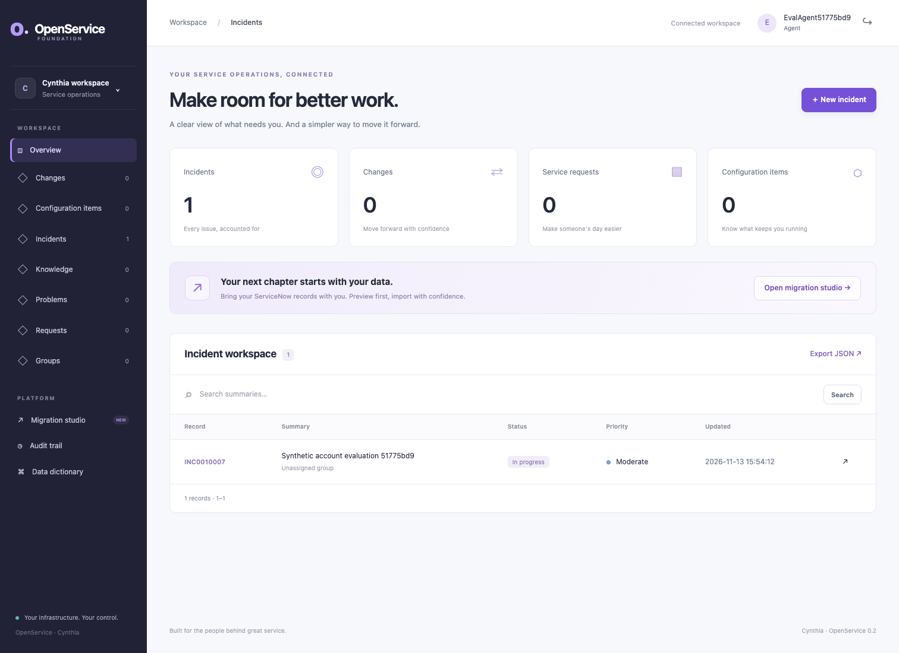
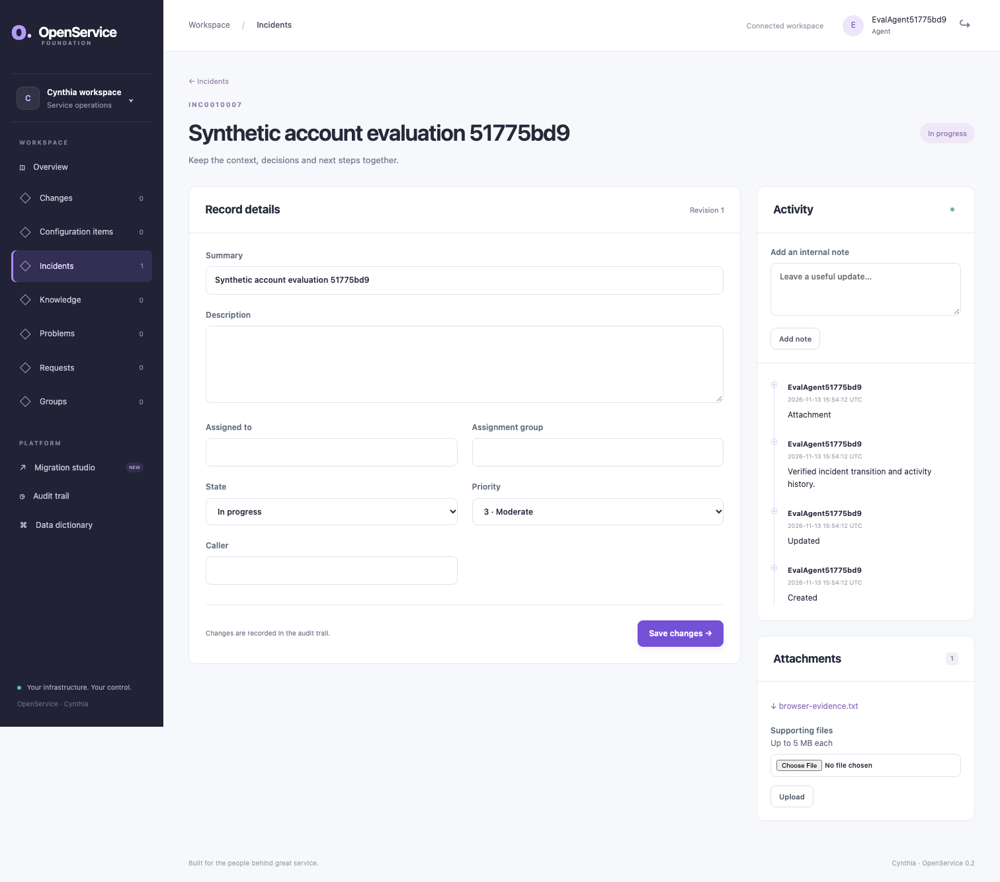
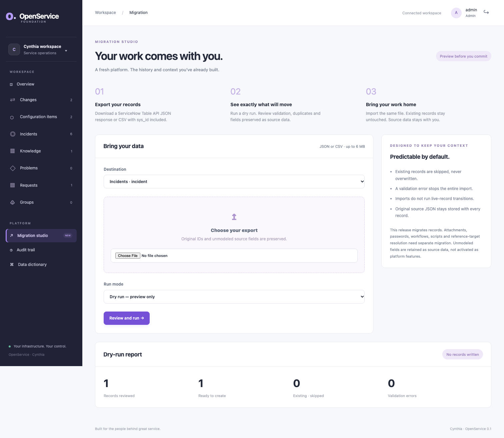
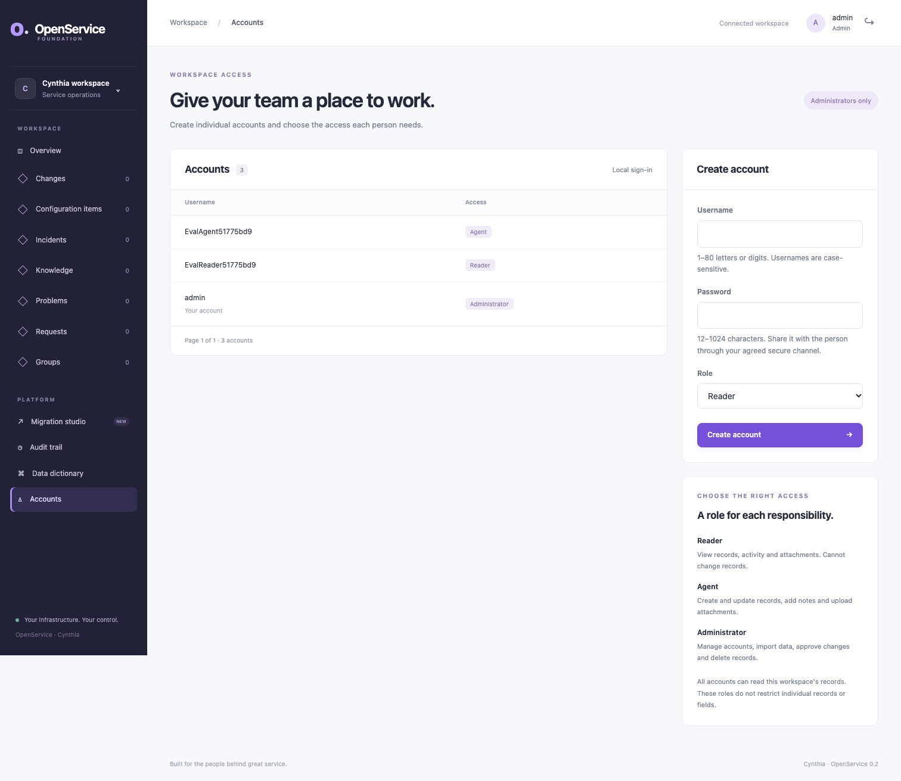
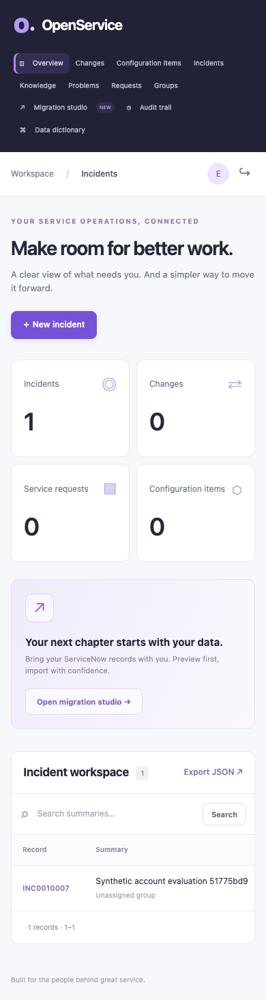

# OpenService

A service operations foundation for Cynthia: clear workspaces, shared records, controlled workflows and a practical path from ServiceNow exports.

Development priorities and adoption gates are defined in the [roadmap and build order](docs/roadmap.md). Local identity, manual invitation/recovery and account lifecycle slices are implemented; scoped access, verified delivery and operational controls remain adoption prerequisites. The current build supports a disposable local walkthrough with synthetic data; shared evaluation and operational pilot gates remain unmet.

## Screenshots

Captured from the Java application in automated Chromium tests with synthetic evaluation data. These are working screens, not design mockups.

### Workspace overview



<details>
<summary>Record details and activity history</summary>



</details>

<details>
<summary>Migration studio and dry-run report</summary>



</details>

<details>
<summary>Administrator account onboarding</summary>



</details>

<details>
<summary>Mobile workspace</summary>



</details>

## Run locally

Requires Java 27 and Docker Compose. Point `JAVA_HOME` at a Java 27 JDK. The project pins Spring Boot 4.1.2 and Maven 3.9.16.

```bash
./mvnw -Dmaven.test.skip=true package
java -jar target/openservice-0.2.0-SNAPSHOT.jar setup
docker compose up --build -d --wait
```

Open **http://localhost:8090**. Sign in as **admin**, using `ADMIN_PASSWORD` from the generated `.env` file. The file is ignored by Git, created with private permissions, and never overwritten by the setup helper. PostgreSQL has no host port; the application binds to loopback only. Changing `ADMIN_PASSWORD` after initialization does not reset the existing database user's password.

`docker compose down` preserves records. The named `database` volume stores records, audit events, attachment bytes and original migration payloads. Do not use `down -v` unless you intend to erase this local data. Back up PostgreSQL before upgrades.

For a first review with colleagues, follow the [evaluation walkthrough](docs/evaluation.md). Administrators can now open **Accounts** to create individual agent and reader logins directly in the browser.

## What works

- Incident, problem, change, request, configuration-item, knowledge and group workspaces.
- Create/edit forms, summary search, pagination, record details and responsive navigation.
- State transitions and administrator approval/rejection for changes, enforced in the API as well as the UI.
- Administrator-only account creation and paginated account lists in the browser; administrator, agent and reader roles, stable identities, password hashes, revocable sessions, CSRF protection and authenticated Basic API access. Administrators can change roles and deactivate/reactivate accounts with last-active-administrator protection.
- Recipient-set passwords through manual, one-time invitations; authenticated password changes; administrator-assisted short-lived recovery; bounded browser-session lifetime and administrator-only lifecycle security events. Links require private manual delivery; email verification and granular record access remain open.
- Activity notes, persistent attachments with binary/multipart upload, metadata/list/download and administrator deletion APIs, audit events and JSON export.
- A shared schema registry used by validation, API services and generated forms.
- A bounded Table API subset: CRUD on unversioned/v1/v2 routes, selected encoded-query operators, sorting, field projection, pagination, optional Link suppression and reads without total-count queries.
- JSON/CSV migration with dry runs, all-or-nothing validation, existing-record skipping, retained IDs and source-payload export.
- Cloud-specific Terraform foundations for AWS, GCP and Azure, backed by managed PostgreSQL.

This is an independently implemented **foundation**, not a full ServiceNow replacement. Most record fields are strings. Groups and references are currently stored values, not an assignment/identity engine. Problem/change/request state values are OpenService defaults. Knowledge is plain text; there is no public portal. Read the [compatibility ledger](docs/servicenow-compatibility.md) before integrating existing clients.

## API example

Use your configured password when curl prompts; do not put passwords into shell history.

```bash
curl -u admin http://localhost:8090/api/now/table/incident \
  -H 'Content-Type: application/json' \
  -d '{"short_description":"Remote access unavailable","priority":"2"}'

curl -u admin --get http://localhost:8090/api/now/table/incident \
  --data-urlencode 'sysparm_query=priority=2^ORDERBYDESCsys_created_on' \
  --data-urlencode 'sysparm_fields=sys_id,number,short_description'
```

See [API scope](docs/api.md), [migration guide](docs/migration.md), [architecture](docs/architecture.md) and [Terraform deployments](terraform/README.md).

## Development and verification

```bash
sh scripts/install-browser.sh
sh scripts/verify.sh
```

The clean Maven build runs the API acceptance and workflow suites against both SQLite and a disposable PostgreSQL 17 Docker container, plus a Java Playwright Chromium journey at laptop, desktop and mobile sizes. It creates no records in an existing demo database. Docker must be running and Chromium installed; missing infrastructure fails the checks instead of skipping them.

JaCoCo requires **100% executable-line, branch and method coverage** across every production Java class, including credential setup, without exclusions. Exact line, method and branch counts are recorded in [validation](docs/validation.md). Reports are generated at `target/site/jacoco/` and `target/surefire-reports/`. Browser screenshots are in `target/browser-artifacts/`; reviewed copies are in `assets/screenshots/`.

For a local JAR, configure `DATABASE_URL`, `SECRET_KEY`, `ADMIN_PASSWORD`, `COOKIE_SECURE=false` (loopback HTTP only) and optionally `PORT`, then run `java -jar target/openservice-0.2.0-SNAPSHOT.jar`. PostgreSQL and SQLite are supported. Use HTTPS and secure cookies for any shared deployment.

Terraform is unchanged by this migration; its separate provider validation and mock-plan commands remain in [the deployment guide](terraform/README.md). No cloud resources were provisioned.

## Operational scope

Cloud configurations provide HTTPS; secure cookies are enabled outside the loopback Docker demo. Each deployment starts with a single application instance with embedded Tomcat. PostgreSQL locks protect record updates; optional `If-Match` revisions prevent lost updates. Startup applies ordered transactional upgrades with a migration journal and serialized schema changes. Follow the [upgrade procedure](docs/platform-foundations.md#ordered-database-upgrades-adopt-02-os-026), using a database backup and planned downtime; rolling upgrades and restore targets remain unverified.

SSO, granular ACL/domain isolation, rate limiting, malware scanning, background workers, email delivery, business-rule scripts and high availability are not implemented. Treat this version as a local evaluation foundation, not a hardened production service. Licensed under the [MIT License](LICENSE), preserving the licence already selected in the Cynthia GitHub repository.

## Count aggregates

The read-only `/api/now/stats/{table}` subset now supports filtered counts, grouping and aggregate ordering over the complete selection. Table and Aggregate APIs both support bounded `IN` and `NOT IN` membership filters. See [API details](docs/api.md) and [validation results](docs/validation.md).

Reusable typed tables, workflow policies and atomic configuration promotion are available in the [configuration workspace](docs/configuration.md), with an [installable service operations example](examples/service-operations.configuration.json). The [ten-area parity baseline](docs/roadmap.md#reusable-parity-baseline--14-november-2026) tracks remaining work.

[Numeric analytics](docs/analytics.md) is available from each workspace for configured integer/decimal fields.

A [disposable PostgreSQL restore drill](docs/recovery.md) verifies configuration, data, attachments, credentials and record-access controls in a fresh database.
